# 이미지 Classification에 적합한 학습 모델 탐색
# **Vegetable Classification**

## 데이터셋

This project uses the [Vegetable Image Dataset](https://www.kaggle.com/datasets/misrakahmed/vegetable-image-dataset) from Kaggle.

* **Classes:** 15 vegetable types (`bean`, `bitter gourd`, `bottle gourd`, `brinjal`, `broccoli`, `cabbage`, `capsicum`, `carrot`, `cauliflower`, `cucumber`, `papaya`, `potato`, `pumpkin`, `radish`, `tomato`)
* **Total Images:** 21,000 images (`224×224`, `.jpg`)
* **Split:** Train (15,000) / Validation (3,000) / Test (3,000)
* **features** : 224 × 224 x 3

### 출처

If you use this dataset, please cite the original paper as requested by the authors:

* M. I. Ahmed, S. M. Mamun, and A. U. Z. Asif, "[DCNN-based vegetable image classification using transfer learning: A comparative study](https://www.researchgate.net/publication/352846889_DCNN-Based_Vegetable_Image_Classification_Using_Transfer_Learning_A_Comparative_Study)," in *2021 5th International Conference on Computer, Communication and Signal Processing (ICCCSP)*, IEEE, 2021, pp. 235–243.

## 전처리
1. 파일 필터링: `suffix.lower() in {".jpg", ".jpeg", ".png"}` | 이미지 파일만 선별해 숨김 파일·비이미지 파일 제외
2. 채널 통일: `.convert("RGB")` | 흑백(1채널)이나 RGBA(4채널) 이미지를 3채널 RGB로 통일
3. 피처 축소 (해상도 축소): `.resize((16, 16), BILINEAR)` | 원본(예: $224 \times 224 \times 3 = 150,528$개)을 $16 \times 16 \times 3 = \mathbf{768}$개 피처로 축소
4. 1차원 평탄화: `.reshape(-1)` | (16, 16, 3) 3차원 배열을 scikit-learn 입력용 1차원 벡터(768,)로 변환
5. 픽셀 정규화: `/ 255.0` | 0 ~ 255 정수 밝기 값을 0.0 ~ 1.0 실수 범위로 스케일링
6. 데이터 타입 통일: `dtype=np.float32 / np.int64` | 피처는 float32(메모리·연산 효율), 레이블은 int64로 고정
7. 레이블 인코딩: `class_to_index` | 15개 채소 폴더명(문자열)을 알파벳순 0~14 정수로 매핑
8. 모델별 선택적 표준화: `make_pipeline(StandardScaler(), ...)` | 거리, 기울기 기반 모델(Logistic Regression, k-NN, SVM, Perceptron, MLP, DNN)에만 평균 0, 표준편차 1로 표준화 적용 (트리 계열은 제외, 파이프라인으로 데이터 누수 방지)

## 입력 파라미터: 랜덤 파라미터 10개 생성
- `PARAMETER_SEED`: 파라미터용 시드
  + 별도로 랜덤 생성 후 각 파라미터 생성에서 공유
- Logistic Regression
  + c: 0.001 ~ 1,000 (loguniform 사용)
  + max_iter: 500 ~ 2000
- k-Nearest Neighbors (k-NN)
  + n_neighbors: 3 ~ 20
  + weights: ["uniform", "distance"]
  + p: 1, 2
- Support Vector Machine (SVM)
  + c: 0.01 ~ 1,000 (loguniform 사용)
  + gamma: 0.00001 ~ 0.1 (loguniform 사용)
  + kernel: ["rbf"]
- Decision Tree
  + criterion: ["gini", "entropy"]
  + max_depth: 3 ~ 50
  + min_samples_leaf: 1 ~ 10
  + max_features: 0.3 ~ 1.0 (uniform 사용)
- Random Forest
  + n_estimators: 50 ~ 200
  + max_depth: 5 ~ 50
  + min_samples_leaf: 1 ~ 5
  + max_features: 0.3 ~ 1.0 (uniform 사용)
- Bagging Classifier
  + n_estimators: 10 ~ 100
  + max_samples: 0.5 ~ 1.0 (uniform 사용)
  + max_features: 0.5 ~ 1.0 (uniform 사용)
  + base_max_depth: 3 ~ 30
- Extra Trees
  + n_estimators: 50 ~ 200
  + max_depth: 5 ~ 50
  + min_samples_leaf: 1 ~ 5
  + max_features: 0.3 ~ 1.0 (uniform 사용)
- AdaBoost
  + n_estimators: 30 ~ 150
  + learning_rate: 0.01 ~ 2.0 (loguniform 사용)
  + base_max_depth: 1 ~ 3
- Gradient Boosting
  + n_estimators: 30 ~ 150
  + learning_rate: 0.01 ~ 0.5 (loguniform 사용)
  + max_depth: 1 ~ 5
  + subsample: 0.5 ~ 1.0 (uniform 사용)
- Perceptron
  + penalty: None, "l2", "l1"
  + alpha: 0.000001 ~ 0.01 (loguniform 사용)
  + eta0: 0.001 ~ 1.0 (loguniform 사용)
  + max_iter: 500 ~ 2000
- Multi-Layer Perceptron (MLP)
  + hidden_layer_sizes: (int(rng.integers(16, 257)),) (은닉층 1개, 뉴런 16 ~ 256개)
  + activation: ["relu", "tanh"]
  + alpha: 0.00001 ~ 0.1
  + max_iter: 30 ~ 100
- Deep Neural Network (DNN)
  + layer_count: 2 ~ 4
  + hidden_layer_sizes: tuple(int(size) for size in rng.integers(16, 257, size=layer_count)) (은닉층 2 ~ 4개, 뉴런 16 ~ 256개)
  + activation: ["relu", "tanh"]
  + alpha: 0.00001 ~ 0.1
  + max_iter: 30 ~ 100
## 성능 비교: 각 모델별 정확도가 가장 높은 5개의 파라미터 조합의 평균값 비교
### Logistic Regression
평균: test accuracy = 0.6699 | train accuracy = 0.8033
 - Top 1: params={'C': np.float64(0.3502718917554013), 'max_iter': 1553} | test_accuracy=0.6713 | train_accuracy=0.8064
 - Top 2: params={'C': np.float64(0.10477323365227816), 'max_iter': 667} | test_accuracy=0.6727 | train_accuracy=0.7821
 - Top 3: params={'C': np.float64(0.25202399872719894), 'max_iter': 515} | test_accuracy=0.6707 | train_accuracy=0.8011
 - Top 4: params={'C': np.float64(0.6041468348066917), 'max_iter': 1639} | test_accuracy=0.6653 | train_accuracy=0.8158
 - Top 5: params={'C': np.float64(0.46737903782076806), 'max_iter': 1358} | test_accuracy=0.6697 | train_accuracy=0.8113
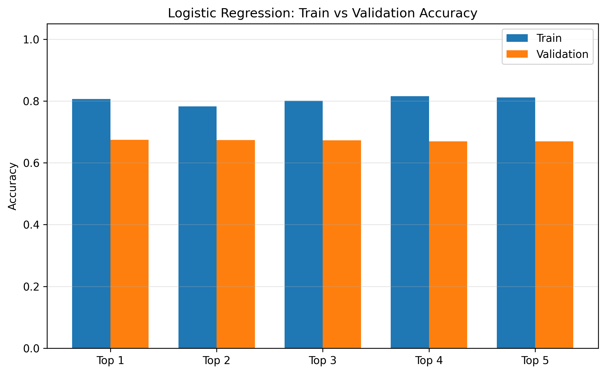
### k-Nearest Neighbors (k-NN)
평균: test accuracy = 0.8039 | train accuracy = 0.9713
-  Top 1: params={'n_neighbors': 11, 'p': 1, 'weights': 'distance'} | test_accuracy=0.8283 | train_accuracy=1.0000
-  Top 2: params={'n_neighbors': 8, 'p': 1, 'weights': 'uniform'} | test_accuracy=0.8153 | train_accuracy=0.8565
-  Top 3: params={'n_neighbors': 9, 'p': 2, 'weights': 'distance'} | test_accuracy=0.8040 | train_accuracy=1.0000
-  Top 4: params={'n_neighbors': 17, 'p': 1, 'weights': 'distance'} | test_accuracy=0.7890 | train_accuracy=1.0000
-  Top 5: params={'n_neighbors': 18, 'p': 1, 'weights': 'distance'} | test_accuracy=0.7830 | train_accuracy=1.0000
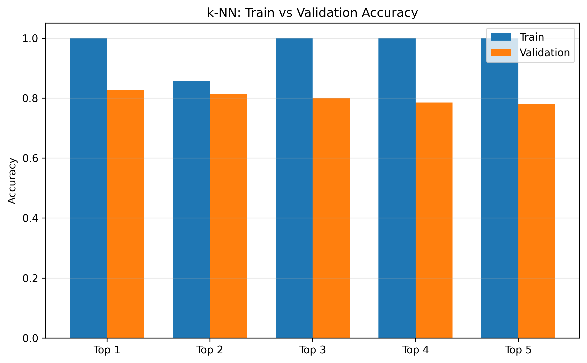
### Support Vector Machine (SVM)
평균: test accuracy = 0.9363 | train accuracy = 0.9938
-  Top 1: params={'C': np.float64(44.00139059238714), 'gamma': np.float64(0.0021602642622069383), 'kernel': 'rbf'} | test_accuracy=0.9573 | train_accuracy=1.0000
-  Top 2: params={'C': np.float64(961.4375218857606), 'gamma': np.float64(0.0012564327892794409), 'kernel': 'rbf'} | test_accuracy=0.9560 | train_accuracy=1.0000
-  Top 3: params={'C': np.float64(1.6777388393177377), 'gamma': np.float64(0.0008544397929536556), 'kernel': 'rbf'} | test_accuracy=0.9227 | train_accuracy=0.9737
-  Top 4: params={'C': np.float64(34.881044844591194), 'gamma': np.float64(0.006034305320476808), 'kernel': 'rbf'} | test_accuracy=0.9270 | train_accuracy=1.0000
-  Top 5: params={'C': np.float64(94.25660090175117), 'gamma': np.float64(0.0001330435200932225), 'kernel': 'rbf'} | test_accuracy=0.9183 | train_accuracy=0.9953
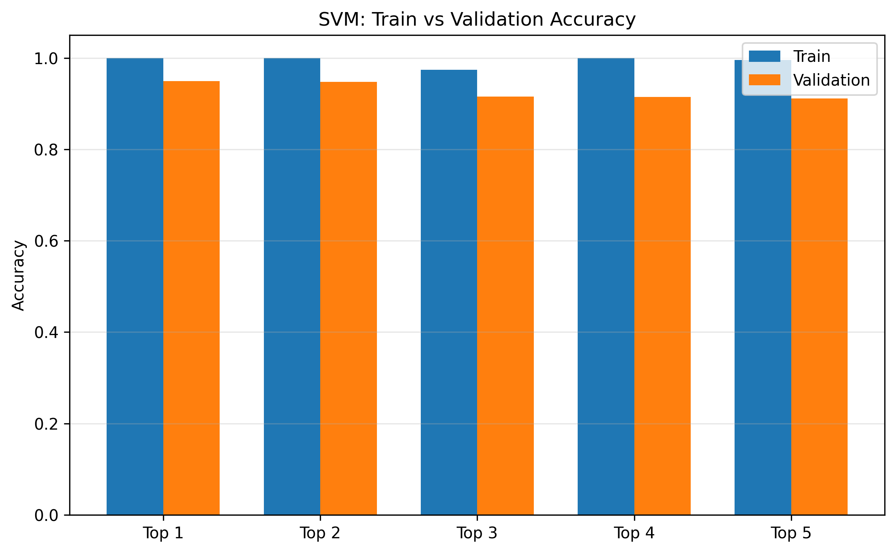
### Decision Tree
평균: test accuracy = 0.5793 | train accuracy = 0.9264
-  Top 1: params={'criterion': 'entropy', 'max_depth': 45, 'max_features': np.float64(0.48438184183808064), 'min_samples_leaf': 1} | test_accuracy=0.5847 | train_accuracy=1.0000
-  Top 2: params={'criterion': 'entropy', 'max_depth': 40, 'max_features': np.float64(0.48590207748087033), 'min_samples_leaf': 1} | test_accuracy=0.5957 | train_accuracy=1.0000
-  Top 3: params={'criterion': 'entropy', 'max_depth': 12, 'max_features': np.float64(0.647599603185538), 'min_samples_leaf': 1} | test_accuracy=0.5717 | train_accuracy=0.8675
-  Top 4: params={'criterion': 'entropy', 'max_depth': 21, 'max_features': np.float64(0.8008884735754034), 'min_samples_leaf': 4} | test_accuracy=0.5693 | train_accuracy=0.8815
-  Top 5: params={'criterion': 'gini', 'max_depth': 21, 'max_features': np.float64(0.32796342556421637), 'min_samples_leaf': 3} | test_accuracy=0.5753 | train_accuracy=0.8829
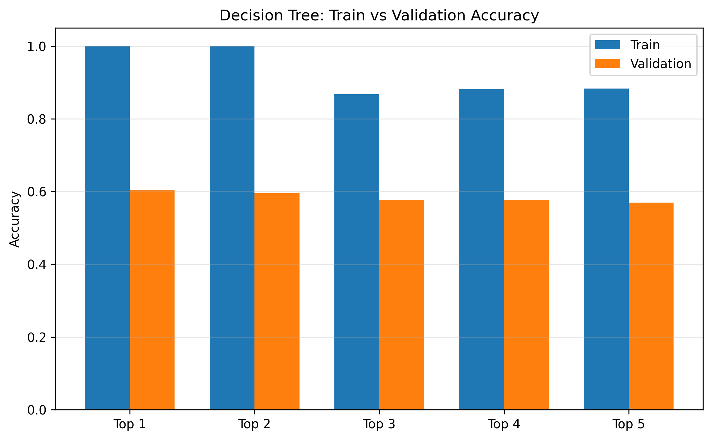
### Random Forest (Decision Tree 기반)
평균: test accuracy = 0.8782 | train accuracy = 0.9998
-  Top 1: params={'max_depth': 47, 'max_features': np.float64(0.412868964648599), 'min_samples_leaf': 1, 'n_estimators': 182} | test_accuracy=0.8950 | train_accuracy=1.0000
-  Top 2: params={'max_depth': 27, 'max_features': np.float64(0.6577668147382395), 'min_samples_leaf': 2, 'n_estimators': 196} | test_accuracy=0.8783 | train_accuracy=0.9999
-  Top 3: params={'max_depth': 47, 'max_features': np.float64(0.49669890222806623), 'min_samples_leaf': 3, 'n_estimators': 165} | test_accuracy=0.8833 | train_accuracy=0.9997
-  Top 4: params={'max_depth': 47, 'max_features': np.float64(0.48438184183808064), 'min_samples_leaf': 3, 'n_estimators': 93} | test_accuracy=0.8740 | train_accuracy=0.9997
-  Top 5: params={'max_depth': 35, 'max_features': np.float64(0.6380442565692083), 'min_samples_leaf': 3, 'n_estimators': 65} | test_accuracy=0.8603 | train_accuracy=0.9996
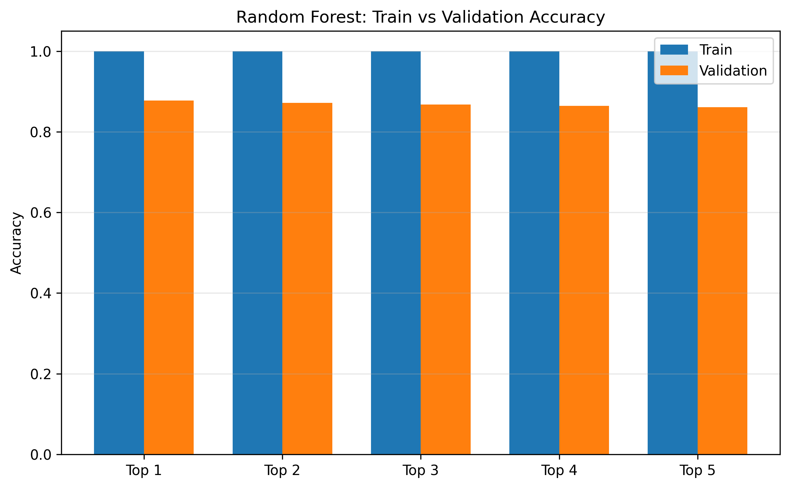
### Bagging Classifier (Decision Tree 기반)
평균: test accuracy = 0.8579 | train accuracy = 0.9981
-  Top 1: params={'base_max_depth': 30, 'max_features': np.float64(0.824542293027221), 'max_samples': np.float64(0.8397952957497588), 'n_estimators': 77} | test_accuracy=0.8657 | train_accuracy=1.0000
-  Top 2: params={'base_max_depth': 21, 'max_features': np.float64(0.8577774811252881), 'max_samples': np.float64(0.66607900647939), 'n_estimators': 93} | test_accuracy=0.8647 | train_accuracy=1.0000
-  Top 3: params={'base_max_depth': 26, 'max_features': np.float64(0.7623924077137898), 'max_samples': np.float64(0.897431177410142), 'n_estimators': 49} | test_accuracy=0.8653 | train_accuracy=1.0000
-  Top 4: params={'base_max_depth': 26, 'max_features': np.float64(0.6969886825702467), 'max_samples': np.float64(0.5211763359571939), 'n_estimators': 96} | test_accuracy=0.8660 | train_accuracy=1.0000
-  Top 5: params={'base_max_depth': 12, 'max_features': np.float64(0.7482854308468129), 'max_samples': np.float64(0.9903740279316868), 'n_estimators': 70} | test_accuracy=0.8277 | train_accuracy=0.9907
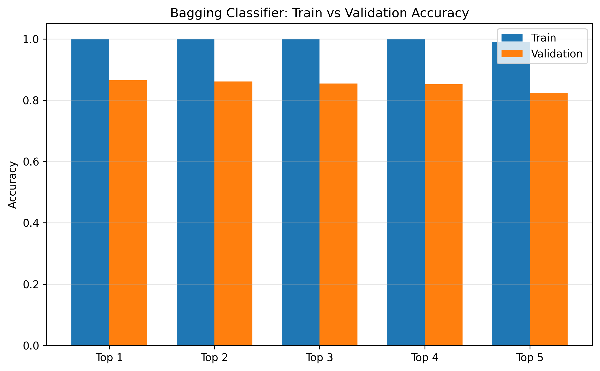
### Extra Trees (Decision Tree 기반)
평균: test accuracy = 0.9016 | train accuracy = 1.0000
-  Top 1: params={'max_depth': 47, 'max_features': np.float64(0.412868964648599), 'min_samples_leaf': 1, 'n_estimators': 182} | test_accuracy=0.9093 | train_accuracy=1.0000
-  Top 2: params={'max_depth': 27, 'max_features': np.float64(0.6577668147382395), 'min_samples_leaf': 2, 'n_estimators': 196} | test_accuracy=0.9027 | train_accuracy=1.0000
-  Top 3: params={'max_depth': 47, 'max_features': np.float64(0.49669890222806623), 'min_samples_leaf': 3, 'n_estimators': 165} | test_accuracy=0.8987 | train_accuracy=1.0000
-  Top 4: params={'max_depth': 42, 'max_features': np.float64(0.6410158363118194), 'min_samples_leaf': 3, 'n_estimators': 110} | test_accuracy=0.9013 | train_accuracy=1.0000
-  Top 5: params={'max_depth': 47, 'max_features': np.float64(0.48438184183808064), 'min_samples_leaf': 3, 'n_estimators': 93} | test_accuracy=0.8960 | train_accuracy=1.0000
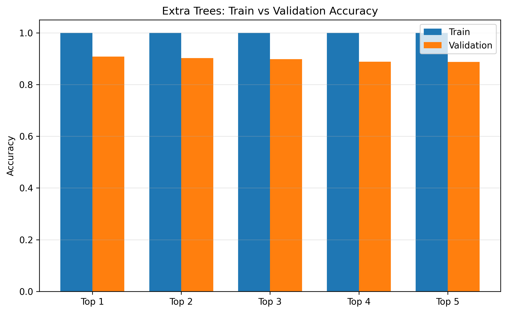
### AdaBoost
평균: test accuracy = 0.4096 | train accuracy = 0.4294
-  Top 1: params={'base_max_depth': 3, 'learning_rate': np.float64(0.040373588785906925), 'n_estimators': 104} | test_accuracy=0.4597 | train_accuracy=0.4712
-  Top 2: params={'base_max_depth': 3, 'learning_rate': np.float64(0.1291856423208951), 'n_estimators': 48} | test_accuracy=0.4527 | train_accuracy=0.4779
-  Top 3: params={'base_max_depth': 3, 'learning_rate': np.float64(1.901799945165288), 'n_estimators': 99} | test_accuracy=0.4057 | train_accuracy=0.4267
-  Top 4: params={'base_max_depth': 2, 'learning_rate': np.float64(0.4078482868970378), 'n_estimators': 44} | test_accuracy=0.3650 | train_accuracy=0.3911
-  Top 5: params={'base_max_depth': 3, 'learning_rate': np.float64(0.012515689160377982), 'n_estimators': 148} | test_accuracy=0.3650 | train_accuracy=0.3803
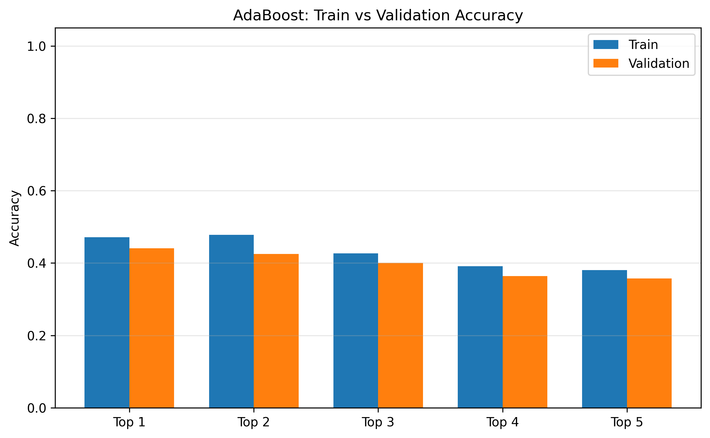
### Gradient Boosting
평균: test accuracy = 0.8011 | train accuracy = 0.9420
-  Top 1: params={'learning_rate': np.float64(0.22722500913574323), 'max_depth': 3, 'n_estimators': 90, 'subsample': np.float64(0.5022691663934102)} | test_accuracy=0.8220 | train_accuracy=0.9716
-  Top 2: params={'learning_rate': np.float64(0.3258246313140321), 'max_depth': 4, 'n_estimators': 134, 'subsample': np.float64(0.6683541956581116)} | test_accuracy=0.8197 | train_accuracy=0.9907
-  Top 3: params={'learning_rate': np.float64(0.25973726900093014), 'max_depth': 3, 'n_estimators': 54, 'subsample': np.float64(0.6759473215950162)} | test_accuracy=0.8067 | train_accuracy=0.9585
-  Top 4: params={'learning_rate': np.float64(0.057009599572869114), 'max_depth': 3, 'n_estimators': 86, 'subsample': np.float64(0.9561080936847617)} | test_accuracy=0.7820 | train_accuracy=0.8874
-  Top 5: params={'learning_rate': np.float64(0.31553651583368125), 'max_depth': 2, 'n_estimators': 53, 'subsample': np.float64(0.9237603432713004)} | test_accuracy=0.7750 | train_accuracy=0.9021
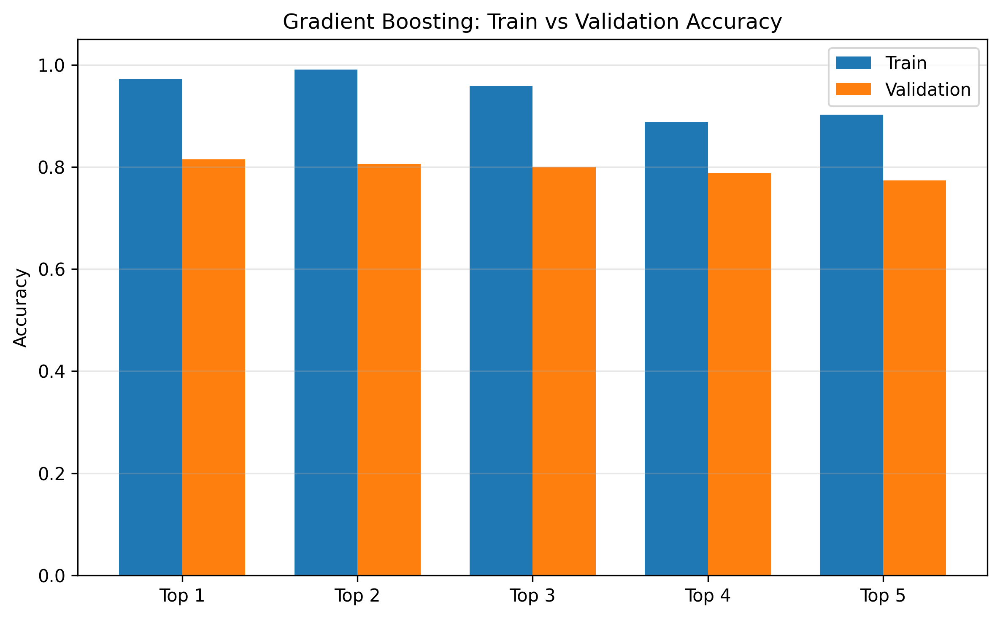
### Perceptron
평균: test accuracy = 0.5047 | train accuracy = 0.5683
-  Top 1: params={'alpha': np.float64(6.022537138335801e-05), 'eta0': np.float64(0.028103544613341816), 'max_iter': 518, 'penalty': 'l1'} | test_accuracy=0.5113 | train_accuracy=0.5810
-  Top 2: params={'alpha': np.float64(4.788404078859786e-05), 'eta0': np.float64(0.003045959567897274), 'max_iter': 921, 'penalty': 'l1'} | test_accuracy=0.5147 | train_accuracy=0.5814
-  Top 3: params={'alpha': np.float64(2.510643507455537e-06), 'eta0': np.float64(0.15348991342280988), 'max_iter': 1334, 'penalty': 'l1'} | test_accuracy=0.5137 | train_accuracy=0.5727
-  Top 4: params={'alpha': np.float64(1.131385282029806e-05), 'eta0': np.float64(0.01552400806457586), 'max_iter': 1658, 'penalty': 'l2'} | test_accuracy=0.4960 | train_accuracy=0.5461
-  Top 5: params={'alpha': np.float64(0.00010407521159109486), 'eta0': np.float64(0.006453109157675144), 'max_iter': 1675, 'penalty': 'l1'} | test_accuracy=0.4880 | train_accuracy=0.5605
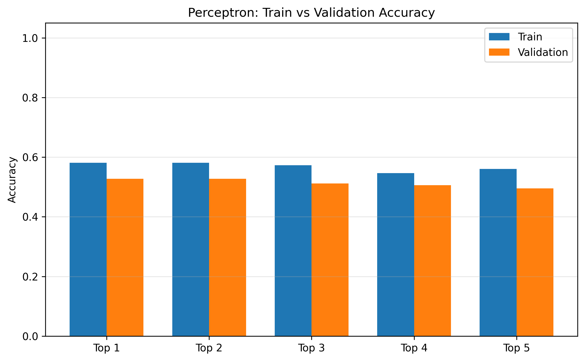
### Multi-Layer Perceptron (MLP)
평균: test accuracy = 0.8948 | train accuracy = 0.9889
-  Top 1: params={'hidden_layer_sizes': (137,), 'activation': 'relu', 'alpha': 0.00013861827264915883, 'max_iter': 37} | test_accuracy=0.9030 | train_accuracy=0.9893
-  Top 2: params={'hidden_layer_sizes': (218,), 'activation': 'tanh', 'alpha': 0.0004506789823165021, 'max_iter': 62} | test_accuracy=0.8943 | train_accuracy=0.9891
-  Top 3: params={'hidden_layer_sizes': (256,), 'activation': 'tanh', 'alpha': 0.004971754501585551, 'max_iter': 95} | test_accuracy=0.9010 | train_accuracy=0.9886
-  Top 4: params={'hidden_layer_sizes': (206,), 'activation': 'tanh', 'alpha': 0.0010152124118579348, 'max_iter': 89} | test_accuracy=0.8907 | train_accuracy=0.9889
-  Top 5: params={'hidden_layer_sizes': (172,), 'activation': 'tanh', 'alpha': 1.4671668787349686e-05, 'max_iter': 77} | test_accuracy=0.8850 | train_accuracy=0.9886
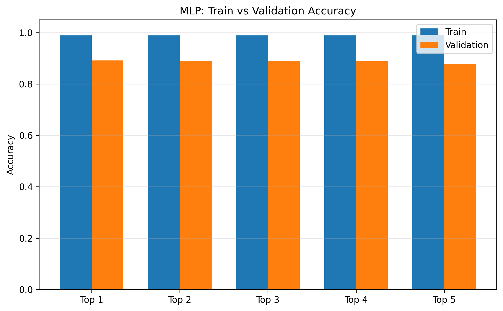
### Deep Neural Network (DNN)
평균: test accuracy = 0.9059 | train accuracy = 0.9904
-  Top 1: params={'hidden_layer_sizes': (192, 74), 'activation': 'relu', 'alpha': 0.004432902201407074, 'max_iter': 95} | test_accuracy=0.9120 | train_accuracy=0.9911
-  Top 2: params={'hidden_layer_sizes': (183, 190, 256), 'activation': 'tanh', 'alpha': 0.004971754501585551, 'max_iter': 95} | test_accuracy=0.9103 | train_accuracy=0.9907
-  Top 3: params={'hidden_layer_sizes': (140, 232, 136, 218), 'activation': 'tanh', 'alpha': 2.6955217443084343e-05, 'max_iter': 85} | test_accuracy=0.9120 | train_accuracy=0.9905
-  Top 4: params={'hidden_layer_sizes': (149, 17, 136), 'activation': 'relu', 'alpha': 0.06240208054279869, 'max_iter': 84} | test_accuracy=0.8950 | train_accuracy=0.9895
-  Top 5: params={'hidden_layer_sizes': (80, 218, 229, 127), 'activation': 'tanh', 'alpha': 0.012986373522790008, 'max_iter': 59} | test_accuracy=0.9003 | train_accuracy=0.9901
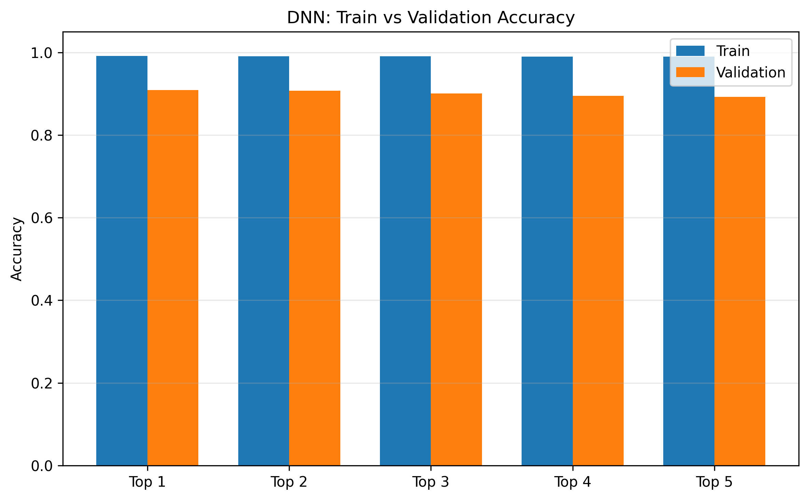

## 정확도 순위
#### Models ranked by top-5 mean test accuracy:
1. SVM: test = 0.9363 | train = 0.9938
2. DNN: test = 0.9059 | train = 0.9904
3. Extra Trees: test = 0.9016 | train = 1.0000
4. MLP: test = 0.8948 | train = 0.9889
5. Random Forest: test = 0.8782 | train = 0.9998
6. Bagging Classifier: test = 0.8579 | train = 0.9981
7. k-NN: test = 0.8039 | train = 0.9713
8. Gradient Boosting: test = 0.8011 | train = 0.9420
9. Logistic Regression: test = 0.6699 | train = 0.8033
10. Decision Tree: test = 0.5793 | train = 0.9264
11. Perceptron: test = 0.5047 | train = 0.5683
12. AdaBoost: test = 0.4096 | train = 0.4294

---
## 한계 및 추후 과제
### 한계
1. 이미지 정보를 충분히 활용하지 못함:이미지를 16X16으로 불여 768개의 픽셀 값으로 펼처 학습하다보니 계산은 단순해 지지만 작은 채소의 모양이나 질감이 사라질 수 있고 인접 픽셀의 공간적 관계도 모델이 직접 활용하기 어려움
2. 학습 데이터와 실제 환경의 차이: 실제 환경과의 차이로 성능이 떨어지는 현상이 존재하므로 데이터셋이 아닌 외부 사진으로 일반화 성능을 확인할 필요가 있음
3. 탐색과 평가의 재현성: 모델 마다 하이퍼파라미터 조합 10개만 무작위로 시도하고, 조합 생성 시드가 매번 달라질 수 있으므로 같은 코드를 다시 실행하여도 동일한 결과를 얻을 수 없음. 추가적으로 여러 모델의 테스트 점수를 보고 최종 모델을 선택하면 테스트 데이터가 모델 선택에 간접적으로 사용될 위험이 있음
4. 정확도만으로는 부족함: 전체 정확도만으로는 어떤 채소를 특히 잘못 분류하는지 파악하기 어려움. 클래스별 정밀도, 재현율, macro-F1, 혼동 행렬도 함께 살펴야 함

### 추후 발전 과제
1. 이미지 전처리 개선: 16X16보다 높은 해상도를 비교하고, 회전, 좌우, 반전, 밝기 변경 같은 데이터 증강을 적용
2. CNN 및 전이 학습 비교: 작은 CNN을 학습하거나 사전 학습된 MobileNet/EfficientNet등을 미세 조정해, 픽셀의 공간적 패턴을 활용
3. 평가 강화: 검증 또는 교차 검증으로 모델을 선택, 클래스별 지표와 혼동 행렬을 함께 보고, 가능하면 별도 출처의 사진으로도 검증
4. 설명 가능성 개선: 트리 모델의 픽셀 중요도만 해석하기보다는 이미지 모델에는 Grad-CAM같은 시각화 기법을 활용해 모델이 실제 채소 부분을 보고 판단하는지 확인
5. 정확도 이외의 다른 성능 척도들과 학습 시간 등을 종합적으로 판단하여 최적의 모델을 선택

---

## **각 모델의 파라미터 및 특이점 설명**
### 1. 선형 · 거리 · 마진 계열

#### Logistic Regression
* **`C` (규제 강도의 역수):**
  * **증가 시:** 규제가 약해져 학습 데이터에 더 밀착(과적합 위험 증가).
  * **감소 시:** 규제가 강해져 가중치 크기를 억제(과소적합 위험 증가, 일반화 방향).
* **`penalty` (`l2`, `l1`, `elasticnet`, `none`):**
  * **`l2`:** 가중치를 고르게 작게 만들어 잡음·공선성에 비교적 안정적.
  * **`l1`:** 일부 가중치를 `0`으로 만들어 특성 선택(Feature Selection) 효과.
* **`max_iter`:** 최적화 반복 횟수. 수렴이 부족할 때 늘려야 함.
* C값이 크고, max_iter값이 작으면 학습이 완료되기 전 max_iter 값에 도달해서 학습을 중지함

#### k-Nearest Neighbors (k-NN)
* **`n_neighbors` (`k`, 이웃 수):**
  * **감소 시(예: `1`, `3`):** 소수 이웃만 참고해 결정 경계가 세밀해지고 **과적합·노이즈 민감도** 상승.
  * **증가 시:** 넓은 범위로 판단해 경계가 매끄러워지나, 과도하면 **과소적합** 발생.
* **`weights` (`uniform`, `distance`):**
  * **`uniform`:** 이웃 `k`개에 동일 가중치 부여.
  * **`distance`:** 가까운 이웃에 더 큰 가중치를 주어 국소적 영향력 확대.
* **`metric` (`euclidean`, `manhattan`, `minkowski` 등):** 거리 계산 기준. 특성 분포와 차원에 따라 이웃 판정 변화.

#### Support Vector Machine (SVM)
* **`C` (규제 파라미터):**
  * **증가 시:** 오분류를 줄이려 경계를 복잡하게 잡음 → **과적합 위험 상승**.
  * **감소 시:** 마진을 넓게 확보 → **과소적합 위험 상승, 일반화 경향**.
* **`kernel` (`linear`, `rbf`, `poly`, `sigmoid`):**
  * **`linear`:** 직선/초평면 경계만 형성.
  * **`rbf` / `poly`:** 비선형 경계 형성 가능하나, 랜덤 데이터에서는 불필요한 복잡도(과적합) 주의.
* **`gamma` (`rbf` / `poly` 커널 영향 반경):**
  * **증가 시:** 한 샘플의 영향 범위가 좁아져 경계가 굴곡짐 → **과적합 경향**.
  * **감소 시:** 영향 범위가 넓어져 경계가 단순·부드러워짐 → **과소적합 경향**.

---

### 2. 트리 및 배깅 계열

#### Decision Tree
* **`max_depth` (최대 트리 깊이):**
  * **증가 시:** 분기를 깊게 이어가며 **과적합 위험 상승**.
  * **감소 시:** 트리가 단순해져 **과소적합 위험 상승**, 해석·일반화 유리.
* **`min_samples_split` / `min_samples_leaf`:** 분할/말단 노드에 필요한 최소 샘플 수.
  * **증가 시:** 세밀한 말단 분기를 제한해 **과적합 억제**.
* **`criterion` (`gini`, `entropy`, `log_loss`):** 분할 기준. 불순도 계산 방식에 따른 미세 분기 차이.

#### Bagging Classifier (Decision Tree 기반)
* **`n_estimators` (기본 추정기 수):** 증가 시 평균/투표 안정성이 높아져 **분산 감소**, 대신 학습·예측 시간 증가.
* **`max_samples` / `max_features`:** 각 기본 모델이 사용할 샘플/특성 비율. 낮출수록 모델 간 다양성 증가(너무 낮으면 개별 모델 약화로 과소적합 가능).
* **`estimator`:** 기본 모델(보통 Decision Tree). 기반 모델의 복잡도가 전체 앙상블 특성에 직접 반영됨.

#### Random Forest (Decision Tree 기반)
* **`n_estimators`:** 트리 수. 증가 시 예측 분산 감소 및 안정화, 연산 시간 증가.
* **`max_features`:** 각 분기에서 고려할 특성 수. 줄일수록 트리 간 상관관계가 낮아져 분산 감소에 유리하나, 너무 작으면 핵심 변수 선택이 어려울 수 있음.
* **`max_depth`, `min_samples_split`, `min_samples_leaf`:** 개별 트리 크기 제한을 통한 과적합 제어 및 속도 조절.

#### Extra Trees (Decision Tree 기반)
* **`n_estimators`:** 트리 수. 증가 시 분산 감소, 계산 비용 증가.
* **`max_features`:** 분기 후보 특성 수. 작을수록 트리 간 다양성 증가.
* **`max_depth`, `min_samples_split`:** 분할 임계값을 무작위로 고르는 특성상 트리가 깊어질 수 있으므로 깊이/샘플 제한으로 과적합과 속도를 조절.

---

### 3. 트리 · 부스팅 계열

#### AdaBoost
* **`n_estimators` (약한 학습기 수):** 증가 시 틀린 샘플을 교정하는 단계가 늘어나지만, 과도하면 **과적합** 및 노이즈 샘플 과집중 위험.
* **`learning_rate`:** 각 약한 학습기의 반영 비율. 낮출수록 천천히 학습해 일반화에 유리하지만, 충분한 성능을 내려면 `n_estimators`를 더 늘려야 함.

#### Gradient Boosting
* **`n_estimators` (트리 수):** 증가 시 잔차/기울기를 줄이는 반복이 늘어나지만, 과도하면 **과적합** 발생.
* **`learning_rate`:** 각 트리의 기여 축소 비율. 낮출수록 과적합 억제는 유리하나 더 많은 트리(`n_estimators`)가 필요.
* **`max_depth` / `subsample`:** `max_depth`가 크면 복잡한 상호작용을 잡지만 과적합 쉬움. `subsample`을 `1.0` 미만으로 두면 일부 샘플만 써서 과적합 완화와 속도 향상에 도움.

---

### 4. 신경망 계열

#### Perceptron
* **`learning_rate` (`eta0`):** 크면 초기 변화가 빠르지만 진동/발산 가능, 작으면 느리지만 안정적.
* **`max_iter` / `tol`:** 최대 반복 횟수 및 수렴 판정 기준. 선형 분리가 어려운 데이터에서는 최대 반복까지 도달할 수 있음.

#### Multi-Layer Perceptron (MLP)
* **`hidden_layer_sizes`:** 은닉층 수와 유닛 수. 늘릴수록 비선형 표현력이 커지지만, 데이터 대비 과도하면 **과적합**과 학습 시간 증가.
* **`activation` (`relu`, `tanh`, `logistic`):** `relu`는 빠른 학습과 기울기 소실 완화에 유리, `tanh`/`logistic`은 포화 구간에서의 기울기 소실 주의.
* **`alpha` ($L_2$ 정규화 강도):** 클수록 가중치 크기를 강하게 제약해 **과적합 억제**.
* **`learning_rate_init` / `batch_size` / `max_iter`:** 초기 학습률, 미니배치 크기, 최대 에폭 수에 따라 수렴 속도와 일반화 차이가 발생.

#### Deep Neural Network (DNN)
* **은닉층 깊이(Depth) 및 폭(Width):** 깊고 넓을수록 표현력이 커지지만 **과적합, 기울기 소실/폭발, 연산량** 증가 위험도 커짐.
* **학습률 및 옵티마이저 (`Adam`, `SGD` 등):** 학습률이 너무 크면 발산/진동, 너무 작으면 수렴 지연.
* **정규화·안정화 (`Dropout` 비율, `BatchNorm`, `Weight Decay`):**
  * `Dropout` 비율이 높으면 과적합 억제는 유리하나 너무 높으면 과소적합 가능.
  * `BatchNorm`과 `Weight Decay`는 학습 안정화와 가중치 크기 제어에 도움.

